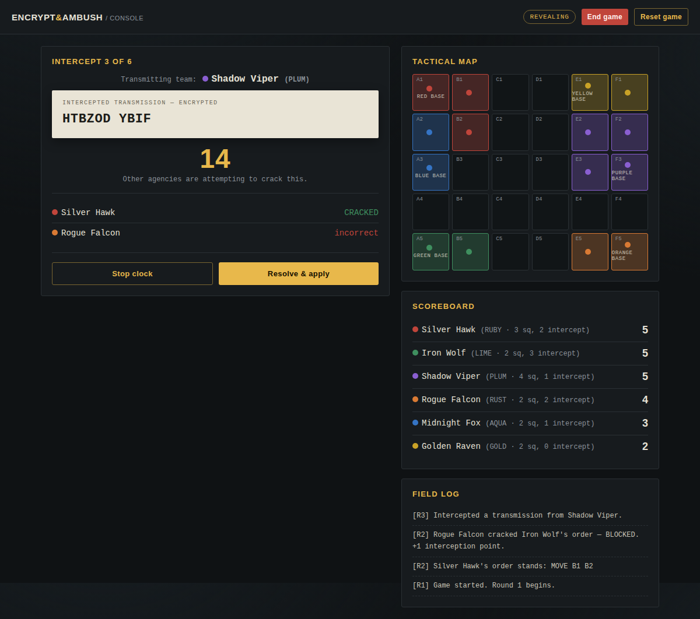
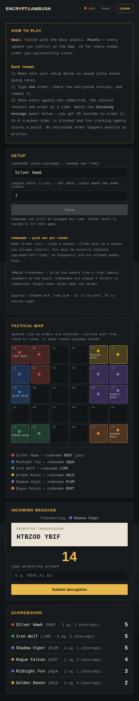

# 🔒 Encrypt & Ambush

**A live, in-browser classroom game for teaching Caesar ciphers and basic cryptanalysis.**

Rival "spy agencies" (student teams) fight for control of a shared digital map. Every
order has to be encrypted before it's sent — and every other team is racing to crack
it before the clock runs out.

---

## What is this?

Encrypt & Ambush is a real-time, multi-device classroom game built as a **single
self-contained web page**. One device (the teacher's, usually projected) runs the
console; every team joins on their own phone or laptop. No app installs, no
accounts for students, no paper.

It was built for teaching the basics of encryption and cryptanalysis — students
directly experience *why* weak ciphers get broken (predictable messages, small
vocabularies, reused keys) rather than just being told about it.

**Curriculum fit:** Digital Technologies / cryptography units (Years 7–10), or as a
lighter, game-based entry point before a more formal treatment in VCE Applied
Computing or similar. Works well as a single 50-minute lesson.

---

## How it plays

1. Teams join automatically — each gets a random team name, a colour and a fixed
   4-letter codename (e.g. RUBY), then chooses a personal Caesar cipher shift (1–25).
2. Each round, every team submits **one** encrypted order before the entry timer
   runs out (teacher sets it, 45 seconds by default):
   - `MOVE <from> <to>` — claim an adjacent empty square
   - `AMBUSH <codename>` — capture that agency's base, unless they defend it
   - `DEFEND` — take your base back and protect it for the rest of the round
     (sent as `DEFEND <your codename>`, the same length as an AMBUSH)
3. The console reveals one encrypted order at a time. Everyone else has
   **30 seconds** to crack it.
4. The first team to crack it earns +1 and chooses, within 15 seconds:
   **BLOCK** (cancel the order), **STEAL** (take 1 point from the sender; the order
   still goes ahead) or, for an ambush, **CHANGE** (redirect it at a new target and
   capture that base themselves). Uncracked orders stand.
5. Points = 1 per square held + 1 extra per base held (a base is worth 2)
   + 1 per crack + points stolen − points lost. Usually 4 rounds — highest score wins.

Full rules, with diagrams, are built into the app itself (the **"How to play"**
option on the landing screen) — nothing needs explaining verbally.

---

## Teachers, classes and access

- **Teacher sign-in with Microsoft.** New teachers fill in a short request form; an
  email with their details opens on their computer for them to send to the owner.
  Requests are approved or rejected on the **Admin** page.
- **One game per class.** Each game has its own 4-character join code, so several
  classes can play at once. Students join with the code — no accounts needed.
- **Lock / close.** Teachers can lock joining once teams are in, and close a game at
  the end of the lesson so students can't keep playing.
- **Roles:** primary owner (can't be removed) › owners (add/remove owners and
  admins) › admins (approve teachers, add admins) › teachers. Enforced by the
  database rules in `database.rules.json`, not just the page.

---

## Features

- **Live multiplayer** across any number of devices, powered by a free Firebase
  backend — no server to run or maintain
- **Up to 6 teams**, auto-assigned a colour and a random codename on join
- **4-letter codenames** for every team (RUBY, AQUA, LIME, GOLD, PLUM, RUST) so
  ciphertext length never gives away who's being targeted
- **Sender identity hidden** during the crack window, on both the console and every
  team's screen — only revealed once the clock stops and it's needed for scoring
- **Three orders — MOVE, AMBUSH, DEFEND** — with live validation: students get
  instant feedback if an order doesn't match a real square, a codename in play, or
  the right format, before they can submit
- **Cracker's choice** — the first team to crack a message picks BLOCK, STEAL or
  CHANGE with radio buttons (no typing), with a 15-second countdown
- **Order-entry timer** — teacher-set countdown; teams that miss it sit the round out
- **Bases worth 2 points**, captured by AMBUSH and recovered by DEFEND
- **A standalone Decoder Wheel** — a visual Caesar-cipher helper any student can
  use any time, independent of the live game, with a built-in cooldown so it can't
  be used to brute-force every shift within the crack window
- **An illustrated "How to Play" page** — step-by-step instructions with diagrams,
  built into the app, plus a quick-access link from every team's own screen
- **A practice round option** — run one full ungraded round to teach the flow.
  Team screens show a "doesn't count" banner; afterwards everyone returns to the
  lobby to choose a new cipher shift (rivals may have cracked the practice one),
  keeping their team, colour and codename
- **Teacher controls**: reshuffle colours, jump to the decoder wheel or back to the
  menu, end the game early, or fully reset back to a clean lobby — all from the
  console's top bar

---

## Getting started

This is one HTML file plus a free Firebase backend. Setup takes about 15 minutes
the first time, and involves no coding.

📖 **[BUILD_GUIDE.md](BUILD_GUIDE.md)** — full setup from scratch: creating the free
Firebase backend, connecting it to the file, and deploying it to a real URL
(covers both a drag-and-drop path and a command-line path).

📖 **[VISUAL_STUDIO_GUIDE.md](VISUAL_STUDIO_GUIDE.md)** — the same setup, but for
teachers who want to manage this through Visual Studio and GitHub rather than a
bare command line.

If you just want to see it running first: open `index.html` in a browser. The
**Decoder Wheel** and **How to Play** pages work immediately with no setup at all
(they don't need the Firebase backend). Joining a team or running a live game does
need the one-time backend setup in the guide above.

---

## What you'll need

| What | Cost |
|---|---|
| A Google account (for the free Firebase backend) | Free |
| A GitHub account (recommended, for storing/updating the file) | Free |
| Any modern browser, on the teacher's device and every team's device | Free |

No installs on student devices. No student accounts or logins. Nothing to mark or
collect afterwards unless you want to.

---

## Tech stack

Everything lives in **one HTML file** — no build step, no framework, no
dependencies beyond two CDN-loaded fonts and the Firebase SDK. State sync between
devices runs on **Firebase Realtime Database** (free tier is more than enough for
classroom use). Hosting is typically **Firebase Hosting**, also free.

This means the whole project is easy to read, easy to fork, and easy to hand to
another teacher — there's no toolchain to set up before you can even open the code.

---

## Known limitations

- Fixed 6×5 board, up to 6 teams, three order types (`MOVE`, `AMBUSH`, `DEFEND`) —
  sized for a single-lesson format
- One live game at a time per Firebase project — don't run two classes
  simultaneously on the same deployed link without resetting between them
- Students can still read a game's raw data (including other teams' shifts) with
  browser developer tools if they go looking — fine for a classroom game, but not
  tamper-proof

See `BUILD_GUIDE.md` for the full, detailed list and the reasoning behind each one.

---

## License / sharing

Feel free to copy, adapt, and reuse this for your own classes. No attribution
required, though it's always appreciated. If you make changes worth sharing back,
consider forking the repo so other teachers can benefit too.

---

## Questions or issues?

This was built iteratively for one teacher's classroom, so rough edges are
expected — if something doesn't work as described, check `BUILD_GUIDE.md`'s
troubleshooting section first, then feel free to dig into `index.html` directly;
it's a single file and every function has a short comment explaining what it does.
